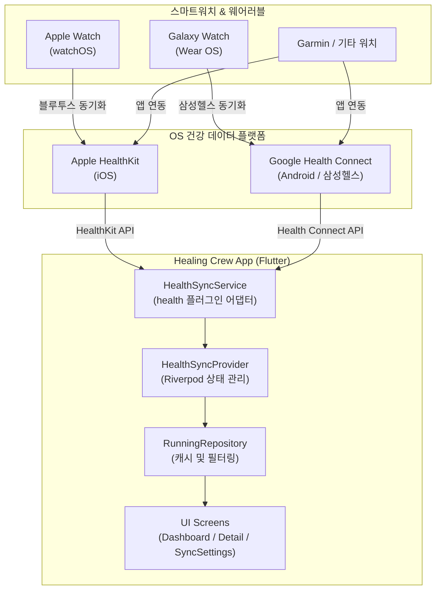

# Healing Crew (힐링 크루) 🏃‍♂️🌿
> **스마트워치 및 모바일 건강 앱(Apple Health / Health Connect) 연동 러닝 기록 & 개인 분석 다이어리**

`Healing Crew`는 스마트워치(Apple Watch, Galaxy Watch, Garmin 등)와 스마트폰 내장 건강 데이터베이스(iOS HealthKit, Android Health Connect)로부터 러닝 운동 세션을 자동으로 수집하여 거리, 페이스, 심박수 구간, 1km 스플릿, 케이던스, 소모 칼로리를 정밀하게 기록하고 시각화해 주는 크로스 플랫폼 Flutter 애플리케이션입니다.

---

## 📱 주요 기능 (Key Features)

1. **자동 건강 데이터 수집 (HealthKit & Health Connect 통합)**
   - **iOS**: Apple HealthKit의 `HKWorkout` 및 심박수, 거리 데이터를 동기화
   - **Android**: Android 14+ 공식 표준인 Google `Health Connect` 연동으로 갤럭시 워치(삼성 헬스), 픽셀 워치 등 Wear OS 기기 기록 자동 수집
   - **Garmin / 써드파티 워치**: 건강 앱과 연동된 모든 워치 데이터 일원화 지원

2. **개인 러닝 분석 대시보드**
   - **주간/월간/연간 마일리지**: 필터별 총 달린 거리, 평균 페이스, 총 시간, 칼로리 집계
   - **주간 목표 프로그레스**: 목표 거리(예: 주 20km) 대비 달성률 실시간 표시
   - **러닝 스트릭(Streak)**: 연속 러닝 일수 자동 계산을 통한 지속적인 동기부여

3. **심층 러닝 세션 인스펙터**
   - **1km Lap Splits**: 1km 구간별 소요 시간 및 페이스 비교 그래프
   - **심박수 5단계 존(Zone 1~5)**: 유산소/무산소/지방 연소 구간별 체류 시간 및 비율 분석
   - **심박수 시계열 곡선**: 러닝 시작부터 종료까지의 심박 변화 추이 차트 (`fl_chart`)
   - **러닝 다이어리 & 메모**: 그날의 컨디션, 날씨, 힐링 회고를 기록하는 메모 기능

4. **개발 및 시뮬레이션 지원 (Mock Simulator)**
   - 실제 스마트워치가 없거나 에뮬레이터 환경에서도 스플릿과 심박 곡선이 포함된 정밀 모의 데이터 5종을 즉시 생성/테스트 가능

---

## 🏗️ 아키텍처 다이어그램 (Architecture)



---

## 🛠️ 기술 스택 (Tech Stack)

| 영역 | 기술 및 라이브러리 | 버전 |
| :--- | :--- | :--- |
| **Framework** | Flutter / Dart | `>=3.10.0` / `>=3.0.0` |
| **State Management** | flutter_riverpod | `^2.5.1` |
| **Health API** | health, permission_handler | `^11.0.0`, `^11.3.1` |
| **Charts & Visuals** | fl_chart, flutter_staggered_animations | `^0.68.0`, `^1.1.1` |
| **Localization & Date** | intl | `^0.19.0` |

---

## 🚀 시작하기 (Getting Started)

### 1. 패키지 설치
```bash
flutter pub get
```

### 2. 플랫폼별 권한 설정 확인
- **iOS (`ios/Runner/Info.plist`)**:
  - `NSHealthShareUsageDescription` (건강 데이터 읽기 권한)
  - `NSHealthUpdateUsageDescription` (건강 데이터 쓰기 권한)
- **Android (`android/app/src/main/AndroidManifest.xml`)**:
  - `android.permission.health.READ_EXERCISE`
  - `android.permission.health.READ_DISTANCE`
  - `android.permission.health.READ_HEART_RATE`
  - Health Connect 패키지 질의(`<queries>`) 및 `ViewPermissionUsageActivity` 인텐트 필터

### 3. 앱 실행
```bash
flutter run
```

> **Tip**: 스마트워치가 연결되어 있지 않은 환경이나 에뮬레이터에서는 우측 상단 동기화 버튼 > `건강 앱 및 워치 연동` 화면에서 **시뮬레이터 / 모의 데이터 모드**를 켜면 실시간으로 테스트 데이터를 체험할 수 있습니다.
